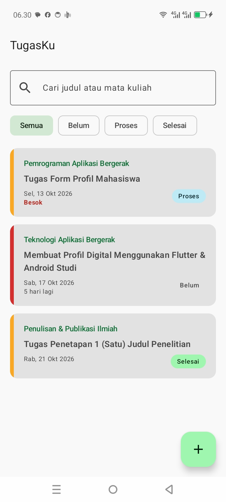
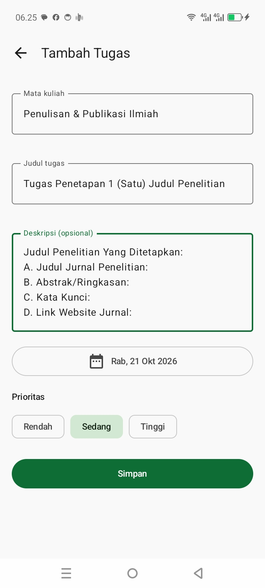
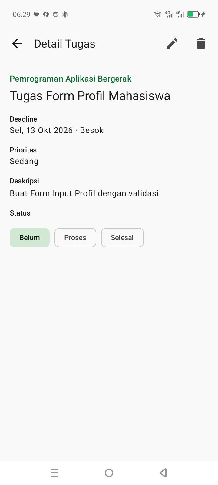
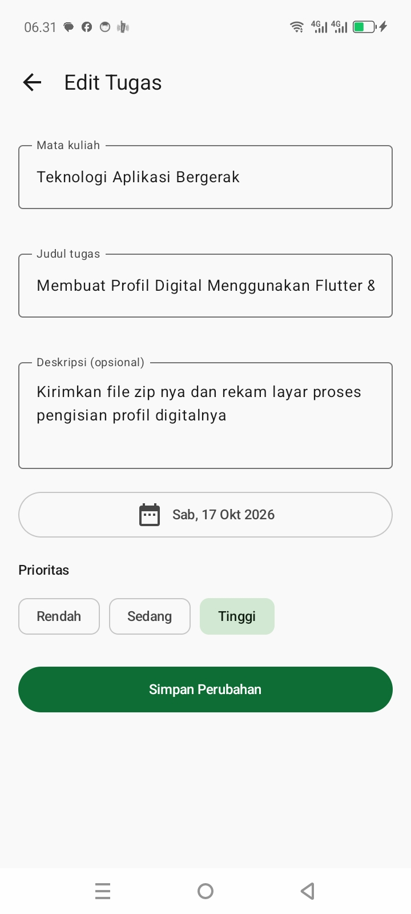
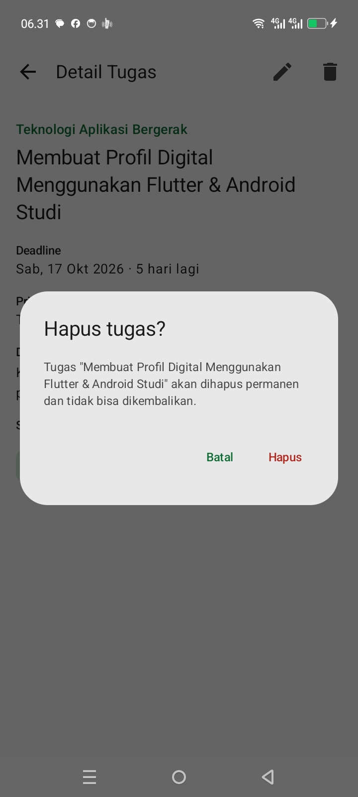
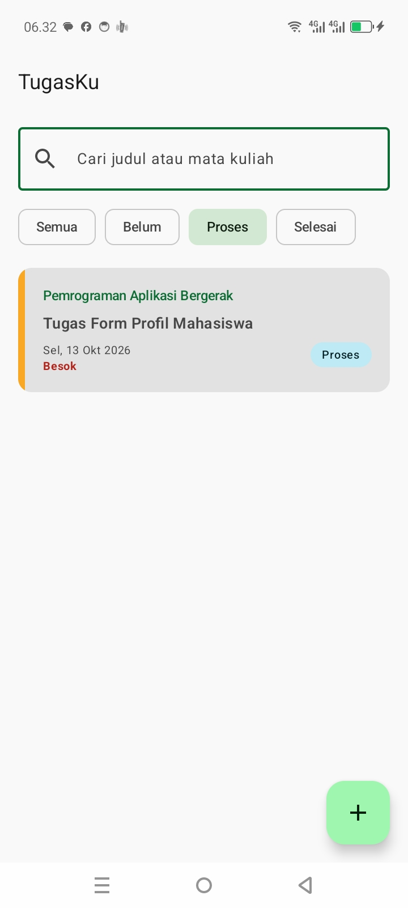
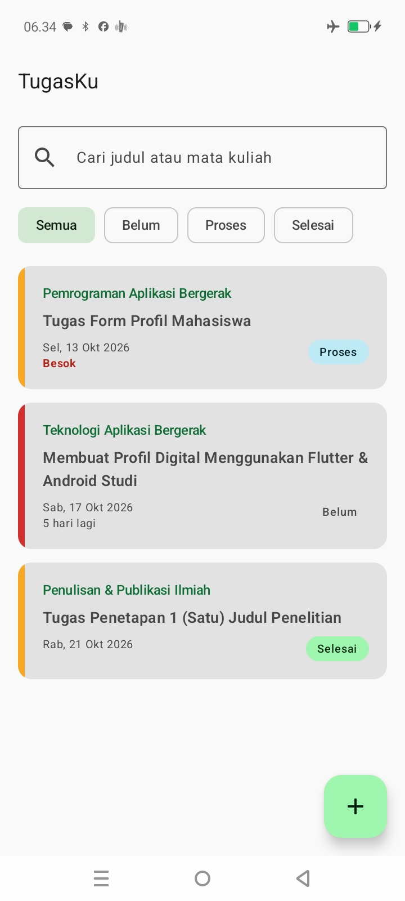

# TugasKu — Aplikasi Manajemen Tugas Mahasiswa (Offline)

Praktikum 1 · Pemrograman Aplikasi Bergerak · Program Studi Informatika, Universitas Mulia

TugasKu membantu mahasiswa mencatat, memantau, dan memperbarui status tugas dari berbagai
mata kuliah **tanpa membutuhkan koneksi internet**. Seluruh data disimpan secara lokal di
database Room sehingga tetap ada setelah aplikasi ditutup atau perangkat dimatikan.

> **Identitas**
> Nama: Ahmad Bagus Rudyanto · NIM: 2411004 · Kelas: IFB5J

---

## Fitur

**Wajib (sesuai studi kasus)**

| # | Fitur | Layar |
|---|-------|-------|
| 1 | Menampilkan daftar tugas dari database lokal | Daftar Tugas |
| 2 | Menambah tugas baru lewat form input (dengan validasi) | Tambah Tugas |
| 3 | Melihat detail satu tugas secara lengkap | Detail Tugas |
| 4 | Mengubah data tugas yang sudah tersimpan | Edit Tugas |
| 5 | Menghapus tugas dengan dialog konfirmasi | Detail Tugas |
| 6 | Mengubah status: **Belum → Proses → Selesai** | Detail Tugas |

**Opsional (sudah diimplementasikan)**

- Filter daftar berdasarkan status (Semua / Belum / Proses / Selesai)
- Pencarian berdasarkan judul atau mata kuliah
- Indikator prioritas (garis warna di kartu) dan penanda deadline dekat / terlambat

## Tech stack

| Komponen | Pustaka |
|----------|---------|
| Bahasa | Kotlin |
| UI | Jetpack Compose + Material 3 |
| State | `ViewModel` + `StateFlow` (`collectAsStateWithLifecycle`) |
| Navigasi | Navigation Compose |
| Penyimpanan lokal | Room 2.8.5 (KSP) |
| Asinkron | Kotlin Coroutines & Flow |
| DI | Manual (`AppContainer`) |

## Arsitektur

Pemisahan tanggung jawab per lapisan; UI **tidak pernah** mengakses database secara langsung.

```
 Compose UI  ──event──▶  ViewModel  ──request──▶  Repository  ──query──▶  Room DAO  ──▶  SQLite
 (Screen)    ◀─state──   (UiState)   ◀──Flow────  (interface)   ◀─Flow──
```

- **Screen (Compose)** — menampilkan `UiState`, mengirim event pengguna ke ViewModel.
- **ViewModel** — menyimpan UI state (`StateFlow`), memetakan data dari repository ke `UiState`.
- **Repository** — satu-satunya pintu data bagi ViewModel (interface + implementasi offline).
- **Room DAO** — query lokal. Mengembalikan `Flow`, sehingga setiap perubahan tabel otomatis
  sampai ke UI.

### Struktur folder

```
app/src/main/java/com/bagus/tugasku/
├── TugasKuApp.kt                 # Application: membuat AppContainer
├── MainActivity.kt
├── di/AppContainer.kt            # manual DI: database + repository
├── data/
│   ├── local/                    # Task (entity), TaskDao, AppDatabase
│   └── repository/               # TaskRepository (interface) + OfflineTaskRepository
├── ui/
│   ├── AppViewModelProvider.kt   # factory ViewModel
│   ├── navigation/               # Routes + AppNavHost
│   ├── components/               # TaskCard, StatusBadge
│   ├── list/                     # TaskListScreen + TaskListViewModel
│   ├── form/                     # TaskFormScreen (Tambah & Edit) + TaskFormViewModel
│   └── detail/                   # TaskDetailScreen + TaskDetailViewModel
└── util/DateUtils.kt
app/src/androidTest/.../TaskDaoTest.kt   # uji CRUD DAO (in-memory)
```

### Model data

| Field | Tipe | Keterangan |
|-------|------|------------|
| `id` | Long (auto) | pembeda setiap tugas |
| `mataKuliah` | String | nama mata kuliah |
| `judul` | String | judul tugas |
| `deskripsi` | String | opsional |
| `deadline` | Long | epoch millis (tengah malam UTC) — dasar pengurutan & penanda deadline dekat |
| `prioritas` | enum | RENDAH / SEDANG / TINGGI |
| `status` | enum | BELUM / PROSES / SELESAI — dasar filter dan progres |

### Alur navigasi

```
Daftar Tugas → Tambah Tugas → Simpan → Daftar Tugas
Daftar Tugas → Detail Tugas → Edit / Hapus → (kembali) → Daftar Tugas
```

## Cara menjalankan

1. Pastikan **Android Studio** versi terbaru terpasang (JDK bawaan Android Studio sudah cukup).
2. Clone repository ini, lalu **Open** foldernya di Android Studio dan tunggu *Gradle sync* selesai.
3. Pilih emulator atau perangkat fisik (minSdk 24), lalu tekan **Run ▶**.
4. Uji offline: aktifkan *Airplane mode*, tambah/ubah tugas, tutup aplikasi sepenuhnya, buka
   lagi — data tetap ada.

### Menjalankan pengujian

Uji DAO membutuhkan emulator/perangkat:

```
./gradlew connectedDebugAndroidTest
```

atau klik kanan `TaskDaoTest` di Android Studio → **Run**.

## Keputusan desain (ringkas)

- **Room** dipilih agar data persisten, query tervalidasi saat kompilasi, dan terintegrasi dengan `Flow`.
- **Repository berbentuk interface** supaya ViewModel mudah diuji dengan fake dan sumber data bisa diganti.
- **Satu `TaskFormScreen`** untuk Tambah dan Edit (beda lewat argumen `taskId`) agar tidak ada duplikasi.
- **Event sekali-jalan** (tutup layar setelah simpan/hapus) memakai `Channel`, bukan flag di state,
  agar tidak terpicu ulang saat rotasi layar.
- **Deadline disimpan sebagai tengah malam UTC** agar tanggal tidak bergeser di zona waktu berbeda.
- **Tanpa `fallbackToDestructiveMigration`**: perubahan skema berikutnya wajib lewat `Migration`
  eksplisit supaya data pengguna tidak hilang.

## Keterbatasan & rencana perbaikan

- Teks UI masih di-*hardcode*; berikutnya dipindah ke `strings.xml` (siap lokalisasi).
- DI manual cukup untuk skala ini; bila membesar, migrasi ke Hilt.
- Draft form belum bertahan saat proses aplikasi dimatikan sistem (hanya `taskId` yang tersimpan).
- Belum ada pengingat deadline (WorkManager + notifikasi) dan ekspor/cadangan data.
- Belum ada UI test Compose; saat ini yang diuji baru lapisan DAO.

## Screenshot

Tangkapan layar dari perangkat fisik (INFINIX X6531B, Android 14):

| Daftar | Tambah | Detail | Edit |
|--------|--------|--------|------|
|  |  |  |  |

| Hapus (konfirmasi) | Filter status | Mode offline |
|--------------------|---------------|--------------|
|  |  |  |

Bukti pendukung: riwayat commit ([08-git-log.png](docs/screenshots/08-git-log.png)) dan hasil uji
instrumentasi `TaskDaoTest`, 5 dari 5 lulus ([09-test.png](docs/screenshots/09-test.png)).

## Video demo

Demo langsung di kelas.
